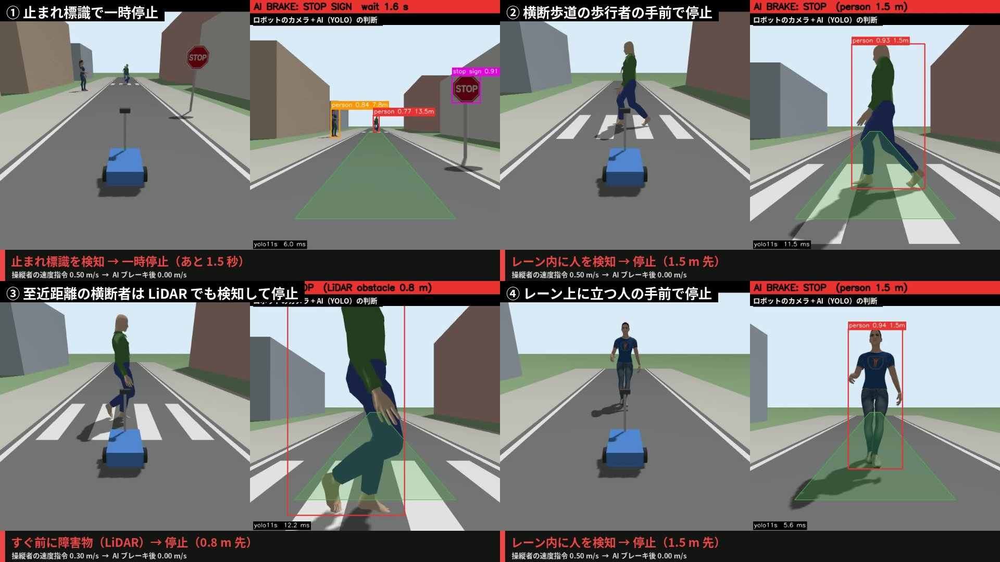
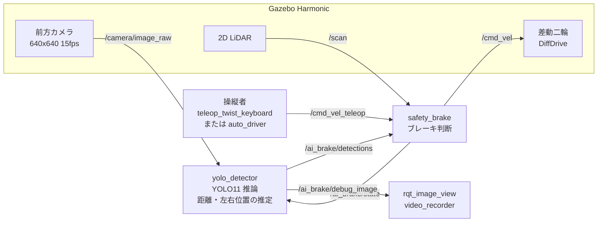
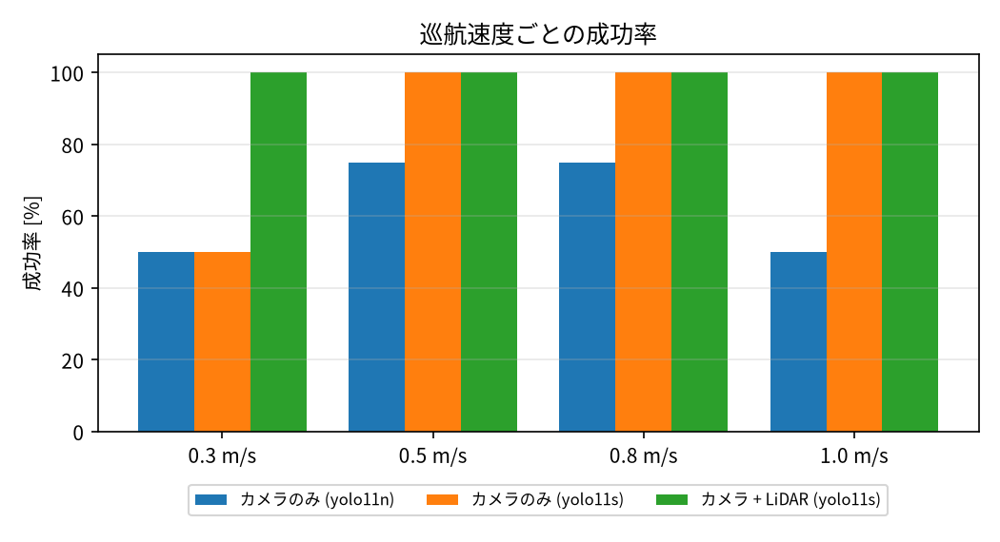
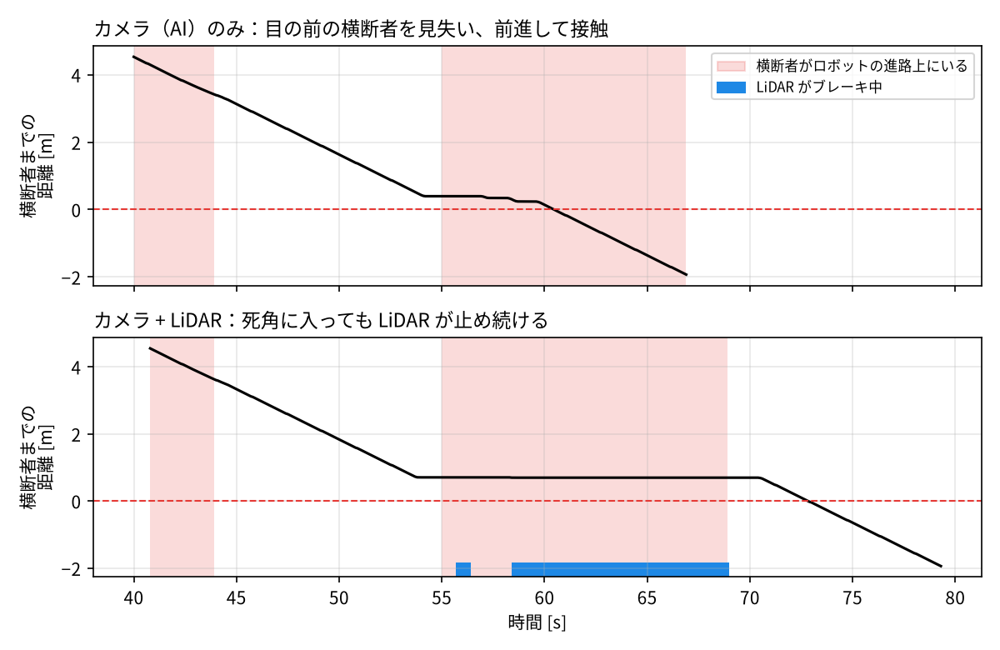
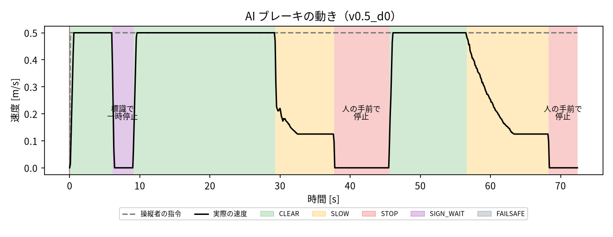

# AI 自動ブレーキ付きロボット

Physical AI 応用1講座 最終課題。操縦者（キーボード操作または自動運転）の速度指令に、AI が「待った」をかけるロボットです。

前方カメラの映像から **YOLO11（COCO 学習済みモデルの推論のみ）** で「人」と「止まれ標識」を見つけ、カメラの幾何から距離を推定します。そのうえで次のように動きます。

- 走行レーン内の人に近づくと **減速 → 停止**
- 止まれ標識の手前で **3 秒間の一時停止**
- 歩道にいる人など、レーン外の人には反応しない

AI カメラの死角（近すぎて全身が映らない人など）は、近距離 LiDAR で補います。

<!-- 提出時に YouTube の URL を記入: [デモ動画](https://youtu.be/xxxxxxxx) -->



各場面の左は外から見た様子、右はロボットのカメラと AI の判断です。下の字幕で、AI ブレーキの判断と速度の変化を表示しています。

## 工夫した点

| 工夫 | 内容 |
|---|---|
| 学習なしで使える AI | COCO 学習済み YOLO11 の `person` と `stop sign` クラスをそのまま利用（推論のみ） |
| 単眼カメラの距離推定 | 人は検出枠の下端（足元）と地面の幾何から、標識は大きさ（対辺 0.6 m）から距離を推定 |
| レーン判定 | 推定した左右位置で、走行レーン内の人だけをブレーキ対象にする（歩道の人には反応しない） |
| 段階的なブレーキ | 4.0 m 以内で距離に応じて減速、1.5 m 以内で停止。停止後は 1.8 m を超えるまで解除しない（じわじわ前進するのを防ぐ） |
| 誤検出・ちらつき対策 | 重なった検出枠を除去（標識＋ポールを囲む誤検出など）。人を一瞬見失っても 1 秒は判断を保持。標識は 2 フレーム連続で検出したときだけ反応 |
| 二重の安全設計 | AI の入力が途絶えたら停止（フェイルセーフ）。カメラの死角は近距離 LiDAR（進路上 0.8 m 以内）で停止 |
| 定量評価 | 速度と歩行者との出会い方を変えて自動で試行し、成功率と停止距離を集計 |
| 動画の自動生成 | 外部視点と AI 視点を並べ、日本語字幕付きの MP4 を録画するノードと仕上げツール |

## システム構成



ROS 2 と Gazebo の間のトピックは `ros_gz_bridge` で中継しています（[config/bridge.yaml](src/ai_brake_bot/config/bridge.yaml)）。

### ブレーキ判断の優先順位

| 状態 | 条件 | 動作 |
|---|---|---|
| `FAILSAFE` | AI の検出結果か LiDAR が 1 秒以上届かない | 完全停止 |
| `STOP`（obstacle） | LiDAR が進路上 0.8 m 以内に何かを検知 | 前進を禁止 |
| `SIGN_WAIT` | 3.0 m 以内に止まれ標識 | 3 秒間停止したあと、その標識は 8 秒間無視して通過 |
| `STOP`（person） | レーン内 1.5 m 以内に人 | 前進を禁止（後退・旋回は可） |
| `SLOW` | レーン内 4.0 m 以内に人 | 距離に応じて減速（最低 25 %） |
| `CLEAR` | 上記以外 | 操縦者の指令をそのまま通す |

判断ロジックは ROS に依存しない純粋な Python（[brake_logic.py](src/ai_brake_bot/ai_brake_bot/brake_logic.py)、[geometry.py](src/ai_brake_bot/ai_brake_bot/geometry.py)）にまとめ、単体テストで確認しています。

## 動作環境

- Ubuntu 24.04 / ROS 2 Jazzy / Gazebo Harmonic（8.x）/ Python 3.12
- NVIDIA GPU を推奨（YOLO11s の推論は約 5 ms/枚。CPU でも動くが遅くなる）

## セットアップ

```bash
# 1. ROS 2 Jazzy と Gazebo 連携パッケージ（sudo が必要）
bash scripts/setup_ros2_jazzy.sh

# 2. YOLO 用の Python 仮想環境（.venv）と学習済みの重み（weights/）
bash scripts/setup_python_env.sh

# 3. ビルド
source /opt/ros/jazzy/setup.bash
colcon build

# 4. 環境の読み込み（ターミナルを開くたびに実行）
source scripts/env.sh
```

`.venv` は ROS 2 と同じシステムの Python を使い、`numpy<2` に固定しています。ROS 2 Jazzy のメッセージ型が NumPy 1.x でビルドされているためです。

## 実行方法

### 1. キーボードで操作する（AI ブレーキを体験）

```bash
# ターミナル 1: Gazebo + AI ブレーキ + 検出結果の表示
source scripts/env.sh
ros2 launch ai_brake_bot sim.launch.py
```

```bash
# ターミナル 2: キーボード操作（i: 前進, k: 停止, j/l: 旋回）
source scripts/env.sh
ros2 run teleop_twist_keyboard teleop_twist_keyboard --ros-args -r cmd_vel:=cmd_vel_teleop
```

人や標識に向かって前進すると、キーを押し続けていても AI が減速・停止させます。Gazebo の画面で、左のエンティティ一覧の `ai_brake_bot` を右クリックして「Follow」を選ぶと、カメラがロボットを追いかけます。

### 2. 自動運転（前を見ていないドライバー役）で走らせる

```bash
ros2 launch ai_brake_bot sim.launch.py mode:=auto speed:=0.5
```

### 3. デモ動画を録画する

```bash
mkdir -p videos
# デモ（0.5 m/s）と、横断者の場面の比較用（0.3 m/s、カメラのみ / カメラ + LiDAR）を録画
ros2 launch ai_brake_bot sim.launch.py mode:=auto headless:=true speed:=0.5 \
  record:=videos/demo_v05.mp4 trial_name:=demo_v05 results_dir:=videos
ros2 launch ai_brake_bot sim.launch.py mode:=auto headless:=true speed:=0.3 use_lidar:=false \
  record:=videos/compare_camera_only.mp4 trial_name:=compare_camera_only results_dir:=videos
ros2 launch ai_brake_bot sim.launch.py mode:=auto headless:=true speed:=0.3 \
  record:=videos/compare_lidar.mp4 trial_name:=compare_lidar results_dir:=videos

# タイトル・見出し・まとめを付けて、提出用の H.264 動画にする
# "ファイル@開始秒-終了秒#見出し|補足" で区間の切り出しと見出し画面を指定。倍速は --speed（最大 2）
python3 tools/make_video.py \
  "videos/demo_v05.mp4#デモ：前を見ていないドライバー役が 0.5 m/s で走行|AI が標識・横断者・立っている人に反応してブレーキをかける" \
  "videos/compare_camera_only.mp4@50-68#比較 ①：カメラ（AI）だけの場合（0.3 m/s）|目の前に来た横断者を見失い、少しずつ前進して接触してしまう" \
  "videos/compare_lidar.mp4@50-74#比較 ②：カメラ + 近距離 LiDAR（0.3 m/s）|AI が見失っても LiDAR が停止を保ち、渡り終えてから発進する" \
  --ending-image docs/images/comparison.png -o videos/submission.mp4
```

`trial_name` を付けると、ロボットが最後の人の手前で止まった時点で自動的に終了します。横断者と出会うタイミングは実行ごとに少しずれるため、比較の場面が録れなかったときは `start_delay:=` を変えて録り直してください。

### 4. 評価する

```bash
OUT=results/lidar_s bash scripts/run_trials.sh                                       # カメラ + LiDAR
USE_LIDAR=false OUT=results/camera_s bash scripts/run_trials.sh                      # カメラ（AI）のみ
MODEL=weights/yolo11n.pt USE_LIDAR=false OUT=results/camera_n bash scripts/run_trials.sh  # 小さいモデル
python3 tools/compare_conditions.py "カメラのみ (yolo11n)=results/camera_n" \
  "カメラのみ (yolo11s)=results/camera_s" "カメラ + LiDAR (yolo11s)=results/lidar_s" \
  --out results/comparison
python3 tools/plot_crossing.py "カメラのみ=videos/compare_camera_only.csv" \
  "カメラ + LiDAR=videos/compare_lidar.csv" -o results/crossing.png
```

`run_trials.sh` は「速度（0.3 / 0.5 / 0.8 / 1.0 m/s）× 走り出しの待ち時間（0 / 12 / 25 / 37 秒）」の 16 通りを試行します。待ち時間を変えると、横断歩道の歩行者（周期 50 秒で往復）と出会うタイミングが変わります。1 条件あたり約 20 分です。

複数の条件を同時に走らせるときは、`ROS_DOMAIN_ID` と `GZ_PARTITION` を条件ごとに変えて通信を分けてください（例: `ROS_DOMAIN_ID=78 GZ_PARTITION=trials_b`）。

### 5. レポートを PDF にする

```bash
python3 tools/make_report_pdf.py --account <omnicampus のアカウント名>
# → 説明資料_PAI最終課題_<アカウント名>.pdf（docs/report.md から作成）
```

### 単体テスト

```bash
cd src/ai_brake_bot && python3 -m pytest test
```

## 実験環境（ワールド）

ロボットは x = 0 から +x 方向へ走ります（[worlds/town_road.sdf](src/ai_brake_bot/worlds/town_road.sdf)）。

| 位置 | 物体 | 期待する動作 |
|---|---|---|
| x = 6 m（右側） | 止まれ標識（自作モデル） | 手前で 3 秒間一時停止 |
| x = 11 m（左の歩道） | 立っている人 | 反応しない（レーン外） |
| x = 16 m | 横断歩道を往復する歩行者（道路中央で 12 秒立ち止まる） | 進路上にいる間は停止して待つ |
| x = 24 m（レーン上） | 立っている人 | 手前で停止（評価の終点） |

## 評価結果

速度（0.3 / 0.5 / 0.8 / 1.0 m/s）と走り出しの待ち時間（0 / 12 / 25 / 37 秒）を組み合わせた 16 通りを、3 つの条件でそれぞれ自動実行しました（計 48 試行）。次の 4 つをすべて満たした試行を成功とします。

- 止まれ標識の手前で一時停止する
- 歩道の人に反応しない
- 横断者が進路上にいる間、0.2 m 以上の余裕を保つ（接触しない）
- レーン上に立つ人の 0.5 m 以上手前で止まる

| 条件 | 0.3 m/s | 0.5 m/s | 0.8 m/s | 1.0 m/s | 合計 | 横断者と接触 | 標識で一時停止 | 歩道の人に誤反応 |
|---|---|---|---|---|---|---|---|---|
| カメラのみ（yolo11n） | 2/4 | 3/4 | 3/4 | 2/4 | **10/16** | 6 回 | 16/16 | 0 回 |
| カメラのみ（yolo11s） | 2/4 | 4/4 | 4/4 | 4/4 | **14/16** | 2 回 | 16/16 | 0 回 |
| カメラ + LiDAR（yolo11s） | 4/4 | 4/4 | 4/4 | 4/4 | **16/16** | 0 回 | 16/16 | 0 回 |



- **モデルを yolo11n から yolo11s に変えると、成功が 10/16 から 14/16 に増えた。** 近くの人を見失う回数が減ったため。
- **カメラのみの失敗は、すべて横断者がロボットの目の前に来た場面だった。** 近すぎて全身が映らず、AI が見失うたびにブレーキが解除され、少しずつ前進して接触した（下図の上段）。
- **LiDAR を加えると 16/16 で成功した。** AI が見失っても、進路上の障害物として停止を保つ（下図の下段）。
- **レーン上に立つ人の手前での停止距離は、速度によらず 1.71〜1.74 m でほぼ一定だった**（ロボット前端から人の中心まで）。距離に応じて減速する効果。
- **推論速度は yolo11s で約 5 ms/枚**（RTX 5000 Ada）。カメラの 15 fps を全フレーム処理できている。





上のグラフは、0.5 m/s で走ったときの速度の変化です。操縦者の指令は常に 0.5 m/s ですが、AI ブレーキが標識・横断者・立っている人の手前で速度を落とし、止めています。

## ファイル構成

```
scripts/        セットアップ・環境読み込み・評価の実行
tools/          標識モデルの生成、評価の集計・比較、提出動画の作成
src/ai_brake_bot/
  ai_brake_bot/
    geometry.py            カメラ幾何（距離推定・レーン判定）と LiDAR の判定
    brake_logic.py         ブレーキ判断（状態遷移）
    yolo_detector_node.py  YOLO 推論 → 検出結果と表示用画像
    safety_brake_node.py   操縦者の指令にブレーキを適用
    auto_driver_node.py    自動運転のドライバー役
    trial_monitor_node.py  評価用の記録と判定
    video_recorder_node.py デモ動画の録画
  config/   パラメータ、ブリッジ設定、DDS 設定
  launch/   sim.launch.py
  models/   ロボット（カメラ・LiDAR 付き差動二輪）、止まれ標識
  worlds/   town_road.sdf
  test/     単体テスト
```

## 開発中に見つけた問題と対策

| 問題 | 原因 | 対策 |
|---|---|---|
| 標識までの距離が実際の半分に推定される | YOLO が「標識だけ」と「標識＋ポール」の 2 つの枠を出し、大きい方で計算していた | 同じクラスで内側に重なる枠を除去し、標識の信頼度のしきい値を 0.6 に |
| 近づいた歩行者を見失う | 頭が画面外に出ると、最小の yolo11n は検出できなくなる | 画像を正方形にして縦の画角を広げ、モデルを yolo11s に |
| AI の入力が時々途絶えて急停止する | 1.2 MB/枚の画像が DDS の共有メモリ（既定 0.5 MB）に入らず UDP で取りこぼされる | Fast DDS の共有メモリ領域を 32 MB に拡張（受信率 5.9 → 15.2 Hz） |
| 低速時に横断者の位置まで進んでしまう | 目の前の人は全身が映らず、AI が見失うたびにブレーキが解除されていた | 近距離 LiDAR で進路上の障害物を検知したら停止する二重化 |
| 試行の終了後も Gazebo が残る | `gz sim` を `sh -c` 経由で起動していたため、終了シグナルが本体に届かない | `gz sim` を直接起動し、終了の猶予を 20 秒に |

## 使用したもの

- [Ultralytics YOLO11](https://github.com/ultralytics/ultralytics)（AGPL-3.0）: COCO 学習済みの重みで推論のみ
- Gazebo Fuel のモデル（初回起動時に自動ダウンロード）: `OpenRobotics/Casual female`、`Mingfei/actor`
- 止まれ標識のメッシュとテクスチャは [tools/make_stop_sign.py](tools/make_stop_sign.py) で自作。Fuel の既存モデルは旧 Gazebo 用の指定のため、Harmonic ではテクスチャが表示されない
- 参考にした講座サンプル: 「ROS2とGazeboの連携によるロボット操作」（自作の差動二輪ロボットをキーボードで操作）。この構成を参考に、ROS 2 Jazzy / Gazebo Harmonic 向けに作り直し、AI によるブレーキ判断、LiDAR、評価、録画を追加した
